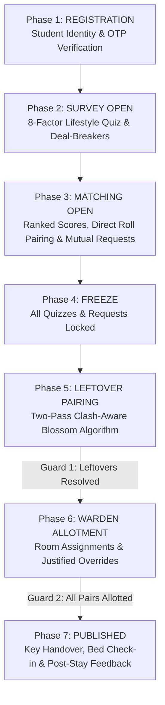

# kindred · intelligent & fair hostel allotment platform

[](https://www.djangoproject.com/)
[](https://www.python.org/)
[](https://networkx.org/)
[](https://www.meity.gov.in/)
[](file:///matcher/tests.py)

> **Where compatibility meets community.**
> Kindred transforms university hostel allocations from stressful, random lotteries into an autonomous, transparent, and fair matching experience. Combining academic roll number verification, an 8-dimensional lifestyle quiz, non-negotiable deal-breaker protection, mutual consent pairing, and Edmonds' Blossom maximum-weight matching, Kindred ensures every student finds their rhythm.

---

## Table of Contents

- [1. System Overview](#1-system-overview)
- [2. The 4 Dedicated Role Portals](#2-the-4-dedicated-role-portals)
- [3. Mathematical & Algorithmic Foundations](#3-mathematical--algorithmic-foundations)
- [4. Empirical Matching Simulation Benchmark](#4-empirical-matching-simulation-benchmark)
- [5. Enterprise-Grade Security Architecture](#5-enterprise-grade-security-architecture)
- [6. Allotment Calendar & Governance Workflow](#6-allotment-calendar--governance-workflow)
- [7. Project Architecture & File Tree](#7-project-architecture--file-tree)
- [8. Quick Start & Installation](#8-quick-start--installation)
- [9. Demo Accounts Matrix](#9-demo-accounts-matrix)
- [10. REST API Reference](#10-rest-api-reference)
- [11. Design Aesthetics & Visual Philosophy](#11-design-aesthetics--visual-philosophy)
- [12. Automated Test Suite (29 Tests)](#12-automated-test-suite-29-tests)
- [13. License & Attribution](#13-license--attribution)


---

## 1. System Overview

Traditional university hostel allotment faces recurring systemic challenges:
1. **Random Roommate Friction**: Incompatible sleep cycles, conflicting study habits, and clashing cleanliness standards lead to constant room transfer requests and disciplinary disputes.
2. **Opaque Administrative Overrides**: Students lack transparency into how rooms are distributed, sparking suspicion of favoritism.
3. **Data Privacy Risks**: Exposing student lifestyle habits publicly violates modern privacy mandates (DPDP Act 2023).
4. **The Leftover Dilemma**: Students who do not form a pair by the deadline are arbitrarily thrown together, often creating the most volatile living situations.

### How Kindred Solves This:
- **Academic Identity Verification**: Every account is strictly tied to a validated student roll number and official college email via cryptographically hashed 6-digit OTP codes.
- **Privacy by Design**: Raw questionnaire responses are never shared. Peers only see mutual harmony scores, shared virtues, and potential clash warnings.
- **Deal-Breaker Protection**: Critical dimensions (e.g., smoking, extreme late-night noise) can be marked as non-negotiable deal-breakers, automatically capping compatibility scores at 59% and alerting students before pairing.
- **Edmonds' Blossom Algorithm**: Unpaired students are paired using graph-theoretic maximum-weight matching, maximizing the total global harmony across the entire cohort.
- **End-to-End Operational Lifecycle**: From initial survey submission to warden approval and room allocation.

---

## 2. The 3 Dedicated Role Portals

Kindred mirrors real-world residential campus governance across three distinct portals:

### 🎓 1. Student Roommate Matcher (`/student/`)
- **Authentication**: College Roll Number or Email + 6-digit time-limited OTP.
- **8 Lifestyle Dimensions**:
  1. `Sleep`: Bedtime habits (Before 10 PM $\to$ 2 AM or later; circular time geometry).
  2. `Wake`: Morning routines (Before 6 AM $\to$ Late morning; circular time geometry).
  3. `Smoke`: Stance on smoking (Smoke-free $\to$ Regular).
  4. `Tidy`: Room tidiness standards (Spotless $\to$ Creative storm).
  5. `Noise`: Ambient noise tolerance (Silent $\to$ Noise doesn't bother me).
  6. `Study`: Ideal study environment (In-room night $\to$ Library $\to$ Anywhere).
  7. `Guests`: Room visitor preferences (Rare $\to$ Open house).
  8. `Social`: Energy recharge habits (Alone $\to$ Close friend $\to$ Big group).
- **Direct Friend Pairing**: Send instant pairing requests by roll number or student name with real-time transaction notifications and hostel block gender policy verification.
- **Privacy Seal (DPDP Act 2023)**: Zero raw questionnaire responses exposed over student-facing APIs; lifestyle clashes redacted to generic labels (`"Major lifestyle rhythm mismatch"`).
- **Post-Stay Feedback Loop**: Evaluate lived roommate compatibility across harmony, sleep, and cleanliness after room allotment.

### 🛡️ 2. Hostel Warden Desk (`/warden/`)
- **Authentication**: Official Staff ID + Staff Password.
- **Live Allotment Queue**: Review confirmed pairs, view mutual compatibility scores, and inspect student branch/year details.
- **Mandatory Re-Allocation Justifications**: Warden room re-assignments require a mandatory justification note, preventing arbitrary room swaps and maintaining a tamper-evident audit trail.
- **Student Disputes & Maintenance Desk**: Ingest, review, and resolve student room change requests, noise complaints, and facility maintenance tickets.
- **Two-Pass Blossom Leftover Matching**: One-click execution of clash-aware maximum-weight leftover pairing with odd-cohort remainder isolation.

### ⚙️ 3. Administrator Governance (`/admin-portal/`)
- **Authentication**: Administrator ID + Master Security Key.
- **7-Phase Allotment Calendar**: Comprehensive phase controller governing system permissions:
  1. `REGISTRATION`: Student identity onboarding & verification.
  2. `SURVEY_OPEN`: Lifestyle quiz completion and edits enabled.
  3. `MATCHING_OPEN`: Ranked match browsing, clash warnings, and mutual request sending.
  4. `FREEZE`: All quizzes and outgoing requests locked down; pairs frozen.
  5. `LEFTOVER_PAIRING`: Automated Blossom maximum-weight algorithm executes.
  6. `WARDEN_ALLOTMENT`: Wardens assign confirmed pairs to designated rooms.
  7. `PUBLISHED`: Allotments made public; students view room numbers and roommate details.
- **Phase Transition Guards**:
  - *Guard 1:* Blocks advancing to `WARDEN_ALLOTMENT` if students remain unpaired before running `LEFTOVER_PAIRING`.
  - *Guard 2:* Blocks advancing to `PUBLISHED` if confirmed pairs lack assigned rooms.
  - Supports administrative override (`force=True`) with mandatory audit logging.
- **Master Roster & CSV Export**: Download the official allotment roster formatted for university administration (`/api/admin/export-csv/`).
- **Audit Trail**: Real-time view of the last 30 system events.

---

## 3. Mathematical & Algorithmic Foundations

### A. Decoupled Continuous Importance vs. Boolean Deal-Breakers
Importance and Deal-breakers represent orthogonal concerns:
- **Importance ($I \in \{1, 2, 3\}$)**: Continuous priority multiplier modulating dimension weight ($\mu(1) = 0.5\times, \mu(2) = 1.0\times, \mu(3) = 2.0\times$).
- **Deal-Breaker ($\text{is\_dealbreaker} \in \{\text{True}, \text{False}\}$)**: Independent boolean veto. If either roommate sets a deal-breaker on dimension $k$ and $\text{sim}_k < 0.5$, a hard veto flag is raised.

### B. Circular Time Geometry for Cyclic Dimensions
For circular schedule metrics (e.g., `sleep` and `wake`), linear distance $|a - b|$ incorrectly penalizes the midnight boundary. Kindred evaluates wrap-around circular distance:
$$\text{dist}(a, b) = \min(|a - b|, \text{Period} - |a - b|)$$
$$\text{sim}_{\text{circular}}(a, b) = 1.0 - \frac{\text{dist}(a, b)}{\text{Period} / 2}$$

### C. Mutual Compatibility Scoring Formula
1. **Directional Harmony Score**:
   $$S_{A \to B} = \frac{\sum_{k} W_{A, k} \cdot \text{sim}_k(A, B)}{\sum_{k} W_{A, k}} \times 100$$
2. **Symmetric Mutual Score**:
   $$S_{\text{mutual}} = \frac{S_{A \to B} + S_{B \to A}}{2}$$
3. **Deal-Breaker Soft Penalty & Blossom Exclusion**:
   If any deal-breaker is violated, $S_{\text{final}} = \min(S_{\text{mutual}}, 59.0)$. Crucially, Blossom Pass 1 filters out these pairs completely so incompatible students are never forced together.

### D. Two-Pass Clash-Aware Edmonds' Blossom Algorithm
Kindred matches leftover students using a graph $G = (V, E, w)$ solved via Edmonds' Blossom algorithm in $O(|V|^3)$ time:
1. **Pass 1 (Clash-Free Graph)**: Only adds edges where `clashes == 0` with edge weight $w(u, v) = S_{\text{final}}(u, v)^2$. Squaring rewards peak compatibility over mediocre compromises.
2. **Pass 2 (Compromise Fallback)**: Any students remaining unpaired are matched on a fallback subgraph with explicit `BLOSSOM_MATCHING_COMPROMISE` audit logging for Warden attention.
3. **Odd Cohort Isolation**: If an odd number of students exist, the single remainder student is flagged with `BLOSSOM_ODD_STUDENT_UNMATCHED` and prioritized for single-room allocation.

---

## 4. Empirical Matching Simulation Benchmark

To mathematically evaluate Kindred's allocation engine against conventional university methods, we benchmarked 4 allocation strategies on a synthetic cohort of **$N = 100$ students** with realistic trait distributions and deal-breaker commitments:

```bash
python manage.py run_benchmark --students=100
```

### Simulation Results ($N = 100$ Students)

| Allocation Strategy | Mean Harmony | Median | Worst Pair (Floor) | Deal-Breaker Clashes | Clash Rate | Runtime |
| :--- | :---: | :---: | :---: | :---: | :---: | :---: |
| **Random Allocation** (Lottery) | 55.52% | 57.99% | 21.92% | 35 pairs | 70.0% | 0.04 ms |
| **Alphabetical Allocation** (Roll No) | 54.97% | 54.45% | 17.88% | 33 pairs | 66.0% | 0.02 ms |
| **Greedy Heuristic Matching** | 83.73% | 85.91% | 59.00% | 2 pairs | 4.0% | 2.34 ms |
| **Edmonds' Blossom (Kindred Two-Pass)** | **85.47%** | **85.48%** | **71.86%** | **0 pairs** | **0.0%** | 91.34 ms |

### Key Benchmark Findings:
1. **Zero Deal-Breaker Clashes**: Kindred's Two-Pass Blossom achieved **0.0% clashes** compared to **70.0%** in random lotteries and **66.0%** in alphabetical assignments.
2. **Satisfaction Floor Elevation**: Blossom lifted the worst-paired student score from **21.92% $\to$ 71.86%** (a **+49.94 percentage point improvement**).
3. **Elimination of the "Tragedy of the Leftovers"**: Greedy heuristics optimize early pairs at the expense of later pairs, leaving the final students with severe mismatches. Blossom's global optimization guarantees fairness across the entire cohort.

---

## 5. Enterprise-Grade Security Architectureity Architecture

```
                 Incoming Request
                        │
            ┌───────────┴───────────┐
            │   CSRF Token Check    │
            └───────────┬───────────┘
                        ▼
            ┌───────────────────────┐
            │  Account Lockout Check│ ── (5 failures ➔ 423 Locked)
            └───────────┬───────────┘
                        ▼
      ┌─────────────────┴─────────────────┐
      │                                   │
      ▼ (Role: Student)                   ▼ (Role: Staff)
┌───────────────────────────┐   ┌───────────────────────────┐
│  Hashed OTP Verification  │   │  PBKDF2 Password Check    │
│  - 5-min expiration       │   │  - Salted PBKDF2-SHA256   │
│  - Max 3 attempts         │   │  - Constant-time compare  │
│  - 60s cooldown (429)     │   └─────────────┬─────────────┘
└─────────────┬─────────────┘                 │
              └───────────────┬───────────────┘
                              ▼
            ┌──────────────────────────────────┐
            │ Session Fixation cycle_key()     │
            │ Reset Failed Attempts            │
            │ Write Immutable AuditLog         │
            └──────────────────────────────────┘
```

| Security Dimension | Implementation | Vulnerability Mitigated |
| :--- | :--- | :--- |
| **Password Storage** | PBKDF2 with SHA-256 (Django default hasher) | Database credential extraction |
| **OTP Generation** | `secrets.choice("0123456789")` | Pseudorandom predictability |
| **OTP Hashing** | Salted `make_password(otp)` in `OTPVerification` table | Plaintext OTP leakage |
| **Attempt Throttling** | `attempts_left` decrements on wrong entry; auto-invalidates at 0 | Online brute-force attacks |
| **Rate Limiting** | 60-second cooldown per student identity on OTP request | SMS/Email flooding & resource exhaustion |
| **Account Lockout** | 5 consecutive bad credentials locks account for 15 minutes (HTTP 423) | Credential stuffing |
| **Session Fixation** | `request.session.cycle_key()` called upon successful authentication | Session hijacking |
| **Data Protection** | Zero raw questionnaire response exposure; DPDP Act 2023 consent tracking | Privacy violations |
| **Audit Logging** | Complete event tracking (`AUTH_LOGIN_SUCCESS`, `AUTH_LOGIN_FAILED_BAD_OTP`, `WARDEN_ALLOT`, etc.) | Non-repudiation & forensic accountability |

---

## 6. Allotment Calendar & Governance Workflow



---

## 7. Project Architecture & File Tree

```
Project/
├── db.sqlite3                                  # SQLite development database
├── manage.py                                   # Django management utility
├── requirements.txt                            # Python dependencies
├── seed_demo_data.py                           # Standalone database seeder
├── .gitignore                                  # Git exclusion rules
├── README.md                                   # Comprehensive documentation
├── kindred_project/                            # Project configuration root
│   ├── __init__.py
│   ├── asgi.py
│   ├── settings.py                             # Settings, installed apps, templates, auth
│   ├── urls.py                                 # Main URL routing configuration
│   └── wsgi.py
├── matcher/                                    # Kindred core allocation application
│   ├── __init__.py
│   ├── admin.py                                # Django admin registrations
│   ├── apps.py                                 # App configuration
│   ├── models.py                               # StudentUser, Room, Pair, Allotment, Ticket, Feedback, etc.
│   ├── scoring.py                              # Mutual compatibility scoring & Blossom matching
│   ├── matching.py                             # Persona calculations & profile code codecs
│   ├── benchmark_matching.py                   # Standalone empirical matching simulation benchmark
│   ├── management/commands/
│   │   ├── seed_data.py                        # Demo data management command
│   │   └── run_benchmark.py                    # Benchmark simulation CLI runner
│   ├── views.py                                # Home, Login, Role portals, APIs, tickets, feedback
│   ├── urls.py                                 # Matcher URL patterns & aliases
│   ├── tests.py                                # Comprehensive automated test suite (29 tests)
│   ├── migrations/                             # Database migrations
│   │   ├── 0001_initial.py
│   │   ├── 0002_allotment_checked_in_allotment_checked_in_at_and_more.py
│   │   ├── 0003_studentuser_failed_login_attempts_and_more.py
│   │   └── 0004_pairscore_algorithm_version_question_cycle_period_and_more.py
│   └── templates/matcher/                      # Glassmorphic responsive templates
│       ├── home.html                           # Public landing page with animated wave & stats
│       ├── login.html                          # Multi-role sign-in portal with OTP generation
│       ├── index.html                          # Student roommate matcher dashboard
│       ├── warden.html                         # Warden allocation & dispute management portal
│       └── admin.html                          # Administrative calendar & governance portal
└── static/                                     # Static frontend assets
    └── matcher.js                              # Student dashboard interactivity & AJAX client
```

---

## 8. Quick Start & Installation

### Prerequisites
- Python 3.10, 3.11, 3.12, 3.13, or 3.14
- Git

### 1. Clone the Repository
```bash
git clone https://github.com/Prashant730/kindred-.git
cd kindred-
```

### 2. Create and Activate Virtual Environment
```bash
# On Windows
python -m venv venv
.\venv\Scripts\activate

# On macOS/Linux
python3 -m venv venv
source venv/bin/activate
```

### 3. Install Dependencies
```bash
pip install -r requirements.txt
```

### 4. Run Migrations & Seed Demo Data
```bash
python manage.py migrate
python seed_demo_data.py
```

### 5. Run the Automated Test Suite (29 Tests)
```bash
python manage.py test
```
*Expected output: `Ran 29 tests in ~4.6s ... OK`*

### 6. Run the Empirical Simulation Benchmark
```bash
python manage.py run_benchmark --students=100
```

### 7. Start the Development Server
```bash
python manage.py runserver 127.0.0.1:8000
```
Open **`http://127.0.0.1:8000/`** in your browser!

---

## 9. Demo Accounts Matrix

All portals feature **1-Click Quick Demo Login** buttons on the sign-in page:

| Role | Name | Identifier (Roll / Staff ID) | Auth Secret (OTP / Password) | Target Dashboard URL |
| :--- | :--- | :--- | :--- | :--- |
| **🎓 Student** | Aarav Patel | `CS26B014` | *Click "Send OTP"* (valid 5 min) | `http://127.0.0.1:8000/student/` |
| **🎓 Student** | Rohan Verma | `EE26B042` | *Click "Send OTP"* (valid 5 min) | `http://127.0.0.1:8000/student/` |
| **🎓 Student** | Kabir Sharma | `ME26B105` | *Click "Send OTP"* (valid 5 min) | `http://127.0.0.1:8000/student/` |
| **🎓 Student** | Meera Nair | `DS26B088` | *Click "Send OTP"* (valid 5 min) | `http://127.0.0.1:8000/student/` |
| **🛡️ Warden** | Dr. V. K. Sharma | `WARDEN-01` | `warden123` | `http://127.0.0.1:8000/warden/` |
| **⚙️ Admin** | Prof. Anjali Verma | `ADMIN-01` | `admin123` | `http://127.0.0.1:8000/admin-portal/` |

---

## 10. REST API Reference

| Endpoint | Method | Role | Description |
| :--- | :---: | :---: | :--- |
| `/api/auth/send-otp/` | `POST` | Public | Generates and hashes 6-digit OTP; enforces 60s cooldown rate limit |
| `/api/auth/login/` | `POST` | Public | Multi-role authentication; verifies OTP or password, cycles session |
| `/api/me/` | `GET` | Student | Returns current user profile, survey status, pairing info, notifications, and phase flags |
| `/api/consent/agree/` | `POST` | Student | Records DPDP Act 2023 privacy consent |
| `/api/students/` | `GET` | Student | Lists verified student directory with branch, year, block |
| `/api/students/switch/`| `POST` | Demo | Switches active student session in demo mode |
| `/api/quiz/submit/` | `POST` | Student | Saves answers to 8 lifestyle dimensions with importance weights and deal-breaker flags |
| `/api/matches/` | `GET` | Student | Computes real-time ranked peer compatibility with Privacy Seal |
| `/api/requests/` | `GET` | Student | Fetches incoming and outgoing pairing requests |
| `/api/requests/send/` | `POST` | Student | Sends pairing request by ID, roll number, or name (enforces max 3 active requests limit) |
| `/api/requests/<id>/respond/`| `POST` | Student | Accepts or declines pairing request; atomic pairing creation |
| `/api/requests/<id>/cancel/` | `POST` | Student | Cancels outgoing pairing request |
| `/api/warden/allot/<id>/` | `POST` | Warden | Allots designated room number; requires justification note for re-allocations |
| `/api/admin/set-phase/` | `POST` | Admin | Updates active allotment calendar phase with Phase Transition Guard validation |
| `/api/admin/run-blossom/`| `POST` | Admin | Executes Two-Pass Edmonds' Blossom matching on leftover students |
| `/api/admin/auto-allot/` | `POST` | Admin | Automates room assignments for confirmed unallotted pairs |
| `/api/admin/export-csv/` | `GET` | Admin | Streams official master allotment report as a `.csv` download |
| `/api/tickets/` | `GET` | Authenticated | Lists complaint & maintenance tickets (filtered by role and status) |
| `/api/tickets/create/` | `POST` | Student | Submits a roommate conflict complaint or maintenance request |
| `/api/tickets/<id>/update-status/` | `POST` | Staff | Updates ticket status with resolution notes and student notification |
| `/api/feedback/submit/` | `POST` | Student | Submits post-stay roommate compatibility evaluation |
| `/api/feedback/summary/` | `GET` | Authenticated | Aggregates actual roommate satisfaction metrics vs algorithm predictions |

---

## 11. Design Aesthetics & Visual Philosophy

Kindred is intentionally designed to evoke warmth, approachability, and editorial elegance, stepping away from cold, generic enterprise software:

- **Typography**:
  - Headings: *Cormorant Garamond* (italic serif, reflecting human literature and university tradition).
  - Body: *Quicksand* (warm geometric sans-serif for clear legibility).
  - Annotations: *Caveat* (handwritten script for human touches and empathetic notes).
- **Color Palette**:
  - Soft blush paper background (`#f8f2f4`) with subtle SVG fractal noise texture.
  - Deep plum ink (`#35293f`) with lavender-grey muted tones (`#6a5d78`).
  - Signature kindred violet (`#8566d1`) and coral-rose (`#e0709f`).
  - Frosted translucent surfaces with 34px rounded radii and `backdrop-filter: blur(14px)`.
- **Signature Sine-Wave Rhythm Animation**:
  - Undulating SVG dual-wave canvas that dynamically synchronizes between *"out of step"*, *"finding each other"*, and *"in rhythm"*.

---

## 12. Automated Test Suite (29 Tests)

Kindred includes a rigorous 29-test unit testing suite in `matcher/tests.py`:

```bash
python manage.py test
```

### Test Coverage Breakdown:
- **Core Operations & Authentication (16 tests)**:
  1. `test_home_page_renders_with_live_stats`
  2. `test_secure_otp_generation_and_verification`
  3. `test_account_lockout_after_consecutive_failures`
  4. `test_staff_hashed_password_success`
  5. `test_student_login_with_otp`
  6. `test_warden_login`
  7. `test_admin_login_and_csv_export`
  9. `test_role_mismatch_denied`
  10. `test_logout`
  11. `test_directional_and_dealbreaker_scoring`
  12. `test_safe_request_concurrency_and_cancellation`
  13. `test_outgoing_request_limit`
  14. `test_phase_enforcement`
  15. `test_blossom_leftover_matching`
  16. `test_privacy_minimum_exposure`
- **Algorithmic Hardening & Privacy Seal (7 tests)**:
  17. `test_circular_time_distance_geometry`
  18. `test_independent_dealbreaker_decoupling`
  19. `test_capacity_aware_room_allotment`
  20. `test_new_governance_models`
  21. `test_two_pass_clash_aware_blossom`
  22. `test_odd_student_cohort_remainder_handling`
  23. `test_privacy_seal_in_api_matches`
- **Governance Guards & Product Features (4 tests)**:
  24. `test_direct_friend_pairing_by_roll_no`
  25. `test_phase_transition_guards`
  26. `test_warden_room_override_mandatory_reason`
  27. `test_complaint_and_maintenance_tickets`
- **Simulation Benchmark & Post-Stay Feedback (2 tests)**:
  28. `test_feedback_submission_and_metrics`
  29. `test_synthetic_matching_benchmark_suite`

---

## 13. License & Attribution

Distributed under the **MIT License**. Developed for modern residential university campuses seeking algorithmic transparency, student compatibility, and streamlined operations.

