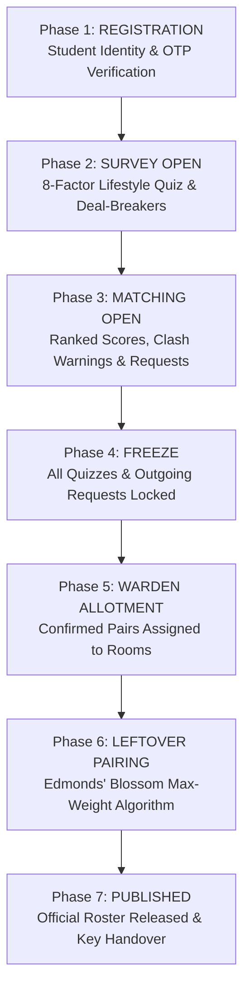

# kindred · intelligent & fair hostel allotment platform

[](https://www.djangoproject.com/)
[](https://www.python.org/)
[](https://networkx.org/)
[](https://www.meity.gov.in/)
[](file:///D:/Project/matcher/tests.py)

> **Where compatibility meets community.**
> Kindred transforms university hostel allocations from stressful, random lotteries into an autonomous, transparent, and fair matching experience. Combining academic roll number verification, an 8-dimensional lifestyle quiz, non-negotiable deal-breaker protection, mutual consent pairing, and Edmonds' Blossom maximum-weight matching, Kindred ensures every student finds their rhythm.

---

## Table of Contents

- [1. System Overview](#1-system-overview)
- [2. The 4 Dedicated Role Portals](#2-the-4-dedicated-role-portals)
- [3. Mathematical & Algorithmic Foundations](#3-mathematical--algorithmic-foundations)
- [4. Enterprise-Grade Security Architecture](#4-enterprise-grade-security-architecture)
- [5. Allotment Calendar & Governance Workflow](#5-allotment-calendar--governance-workflow)
- [6. Project Architecture & File Tree](#6-project-architecture--file-tree)
- [7. Quick Start & Installation](#7-quick-start--installation)
- [8. Demo Accounts Matrix](#8-demo-accounts-matrix)
- [9. REST API Reference](#9-rest-api-reference)
- [10. Design Aesthetics & Visual Philosophy](#10-design-aesthetics--visual-philosophy)
- [11. Automated Test Suite](#11-automated-test-suite)
- [12. License & Attribution](#12-license--attribution)

---

## 1. System Overview

Traditional university hostel allotment faces recurring systemic challenges:
1. **Random Roommate Friction**: Incompatible sleep cycles, conflicting study habits, and clashing cleanliness standards lead to constant room transfer requests and disciplinary disputes.
2. **Opaque Administrative Overrides**: Students lack transparency into how rooms are distributed, sparking suspicion of favoritism.
3. **Data Privacy Risks**: Exposing student lifestyle habits publicly violates modern privacy mandates (DPDP Act 2023).
4. **The Leftover Dilemma**: Students who do not form a pair by the deadline are arbitrarily thrown together, often creating the most volatile living situations.

### How Kindred Solves This:
- **Academic Identity Verification**: Every account is strictly tied to a validated student roll number and official college email via cryptographically hashed 6-digit OTP codes.
- **Privacy by Design**: Raw questionnaire responses are never shared. Peers only see mutual harmony scores, shared virtues, and potential clash warnings.
- **Deal-Breaker Protection**: Critical dimensions (e.g., smoking, extreme late-night noise) can be marked as non-negotiable deal-breakers, automatically capping compatibility scores at 59% and alerting students before pairing.
- **Edmonds' Blossom Algorithm**: Unpaired students are paired using graph-theoretic maximum-weight matching, maximizing the total global harmony across the entire cohort.
- **End-to-End Operational Lifecycle**: From initial survey submission to warden approval, physical room key handover, and caretaker bed check-in.

---

## 2. The 4 Dedicated Role Portals

Kindred mirrors real-world residential campus governance across four distinct portals:

### 🎓 1. Student Roommate Matcher (`/student/`)
- **Authentication**: College Roll Number or Email + 6-digit time-limited OTP.
- **8 Lifestyle Dimensions**:
  1. `Sleep`: Bedtime habits (Before 10 PM $	o$ 2 AM or later)
  2. `Wake`: Morning routines (Before 6 AM $	o$ Late morning)
  3. `Smoke`: Stance on smoking (Smoke-free $	o$ Regular)
  4. `Tidy`: Room tidiness standards (Spotless $	o$ Creative storm)
  5. `Noise`: Ambient noise tolerance (Silent $	o$ Noise doesn't bother me)
  6. `Study`: Ideal study environment (In-room night $	o$ Library $	o$ Anywhere)
  7. `Guests`: Room visitor preferences (Rare $	o$ Open house)
  8. `Social`: Energy recharge habits (Alone $	o$ Close friend $	o$ Big group)
- **Persona Archetypes**: Automatic classification into personas such as *Midnight Curator*, *Dawn Host*, *Daylight Scholar*, *Moonlit Dreamer*, or *Sage*.
- **Mutual Compatibility Scoring**: Real-time percentage score with directional weighting.
- **Anti-Monopoly Constraints**: Students can hold at most **3 active outgoing requests** at any time. Requests automatically expire after **48 hours** if unresponded.
- **Mutual Consent Confirmation**: A pair is confirmed only when both students consent.

### 🛡️ 2. Hostel Warden Desk (`/warden/`)
- **Authentication**: Official Staff ID + Staff Password.
- **Live Allotment Queue**: Review confirmed pairs, view mutual compatibility scores, and inspect student branch/year details.
- **Room Allocation Overrides**: Assign vacant rooms across hostel blocks with automatic floor and accessibility priority verification.
- **Leftover Blossom Execution**: One-click trigger to execute Edmonds' Blossom matching on all remaining unpaired residents.

### 🔑 3. Caretaker Facility Desk (`/caretaker/`)
- **Authentication**: Caretaker ID + Desk Passcode.
- **Room Occupancy Grid**: Visual real-time card view of every room in the hostel block, occupant names, and vacant beds.
- **Physical Bed Check-In**: Instant toggle recording student physical arrival with timestamps.
- **Room Key Distribution**: Track physical brass key issuance and desk recall.
- **Maintenance Notes**: Record room damage, repairs, and amenity conditions.

### ⚙️ 4. Administrator Governance (`/admin-portal/`)
- **Authentication**: Administrator ID + Master Security Key.
- **7-Phase Allotment Calendar**: Comprehensive phase controller governing system permissions:
  1. `REGISTRATION`: Student identity onboarding & verification.
  2. `SURVEY_OPEN`: Lifestyle quiz completion and edits enabled.
  3. `MATCHING_OPEN`: Ranked match browsing, clash warnings, and mutual request sending.
  4. `FREEZE`: All quizzes and outgoing requests locked down; pairs frozen.
  5. `WARDEN_ALLOTMENT`: Wardens assign confirmed pairs to designated rooms.
  6. `LEFTOVER_PAIRING`: Automated Blossom maximum-weight algorithm executes.
  7. `PUBLISHED`: Allotments made public; students view room numbers and roommate details.
- **Master Roster**: Complete table of all registered students, pairing status, and allotted rooms.
- **1-Click CSV Export**: Download the official allotment roster formatted for university administration (`/api/admin/export-csv/`).
- **Audit Trail**: Real-time view of the last 30 system events.

---

## 3. Mathematical & Algorithmic Foundations

### A. Mutual Compatibility Scoring Formula
Compatibility between Student $A$ and Student $B$ is directional and asymmetric because what Student $A$ values may differ from what Student $B$ values.

1. **Normalized Dimension Similarity**:
   $$	ext{sim}_k(A, B) = 1.0 - rac{|A_k - B_k|}{	ext{Range}_k - 1}$$
   Where $	ext{Range}_k$ is the question range (e.g., $4 - 1 = 3$).

2. **Importance Weighting Multiplier**:
   $$W_k = 	ext{BaseWeight}_k 	imes \mu(I_{A, k})$$
   $$\mu(I) = egin{cases} 0.5 & 	ext{if } I = 1 	ext{ (A little)} \ 1.0 & 	ext{if } I = 2 	ext{ (It matters)} \ 2.0 & 	ext{if } I = 3 	ext{ (Deal-breaker)} \end{cases}$$

3. **Directional Harmony Score**:
   $$S_{A 	o B} = rac{\sum_{k} W_k \cdot 	ext{sim}_k(A, B)}{\sum_{k} W_k} 	imes 100$$

4. **Symmetric Mutual Score**:
   $$S_{	ext{mutual}} = rac{S_{A 	o B} + S_{B 	o A}}{2}$$

5. **Deal-Breaker Clash Penalty**:
   If either student set $I_k = 3$ (Deal-breaker) and $	ext{sim}_k < 0.5$:
   $$S_{	ext{final}} = \min(S_{	ext{mutual}}, 59.0)$$
   This mathematical cap guarantees that contradictory lifestyle habits can never result in a passing compatibility score ($\ge 60\%$).

### B. Edmonds' Blossom Maximum-Weight Matching
For leftover unpaired students in a hostel block, Kindred builds a general weighted graph $G = (V, E, w)$:
- Vertices $V$: Unpaired students of the same hostel block.
- Edges $E$: Compatibility between any two students where no deal-breaker is violated.
- Edge Weights $w(u, v) = S_{	ext{final}}(u, v)^2$: Squaring the score incentivizes higher individual matches over mediocre compromises.

Using `networkx.max_weight_matching(G, maxcardinality=True)`, the algorithm executes Edmonds' Blossom algorithm in $O(|V|^3)$ time. It handles odd-length cycles by contracting blossoms, guaranteeing the maximum total global satisfaction across the cohort.

---

## 4. Enterprise-Grade Security Architecture

```
                 Incoming Request
                        │
            ┌───────────┴───────────┐
            │   CSRF Token Check    │
            └───────────┬───────────┘
                        ▼
            ┌───────────────────────┐
            │  Account Lockout Check│ ── (5 failures ➔ 423 Locked)
            └───────────┬───────────┘
                        ▼
      ┌─────────────────┴─────────────────┐
      │                                   │
      ▼ (Role: Student)                   ▼ (Role: Staff)
┌───────────────────────────┐   ┌───────────────────────────┐
│  Hashed OTP Verification  │   │  PBKDF2 Password Check    │
│  - 5-min expiration       │   │  - Salted PBKDF2-SHA256   │
│  - Max 3 attempts         │   │  - Constant-time compare  │
│  - 60s cooldown (429)     │   └─────────────┬─────────────┘
└─────────────┬─────────────┘                 │
              └───────────────┬───────────────┘
                              ▼
            ┌──────────────────────────────────┐
            │ Session Fixation cycle_key()     │
            │ Reset Failed Attempts            │
            │ Write Immutable AuditLog         │
            └──────────────────────────────────┘
```

| Security Dimension | Implementation | Vulnerability Mitigated |
| :--- | :--- | :--- |
| **Password Storage** | PBKDF2 with SHA-256 (Django default hasher) | Database credential extraction |
| **OTP Generation** | `secrets.choice("0123456789")` | Pseudorandom predictability |
| **OTP Hashing** | Salted `make_password(otp)` in `OTPVerification` table | Plaintext OTP leakage |
| **Attempt Throttling** | `attempts_left` decrements on wrong entry; auto-invalidates at 0 | Online brute-force attacks |
| **Rate Limiting** | 60-second cooldown per student identity on OTP request | SMS/Email flooding & resource exhaustion |
| **Account Lockout** | 5 consecutive bad credentials locks account for 15 minutes (HTTP 423) | Credential stuffing |
| **Session Fixation** | `request.session.cycle_key()` called upon successful authentication | Session hijacking |
| **Data Protection** | Zero raw questionnaire response exposure; DPDP Act 2023 consent tracking | Privacy violations |
| **Audit Logging** | Complete event tracking (`AUTH_LOGIN_SUCCESS`, `AUTH_LOGIN_FAILED_BAD_OTP`, `CARETAKER_CHECKIN`, etc.) | Non-repudiation & forensic accountability |

---

## 5. Allotment Calendar & Governance Workflow



---

## 6. Project Architecture & File Tree

```
Project/
├── db.sqlite3                                  # SQLite development database
├── manage.py                                   # Django management utility
├── requirements.txt                            # Python dependencies
├── seed_demo_data.py                           # Standalone database seeder
├── .gitignore                                  # Git exclusion rules
├── README.md                                   # Comprehensive documentation
├── kindred_project/                            # Project configuration root
│   ├── __init__.py
│   ├── asgi.py
│   ├── settings.py                             # Settings, installed apps, templates, auth
│   ├── urls.py                                 # Main URL routing configuration
│   └── wsgi.py
├── matcher/                                    # Kindred core allocation application
│   ├── __init__.py
│   ├── admin.py                                # Django admin registrations
│   ├── apps.py                                 # App configuration
│   ├── models.py                               # StudentUser, Room, Pair, Allotment, OTPVerification, etc.
│   ├── scoring.py                              # Mutual compatibility scoring & Blossom matching
│   ├── matching.py                             # Persona calculations & profile code codecs
│   ├── views.py                                # Home, Login, Role portals, APIs, and auth handlers
│   ├── urls.py                                 # Matcher URL patterns & aliases
│   ├── tests.py                                # Comprehensive automated unit test suite (16 tests)
│   ├── migrations/                             # Database migrations
│   │   ├── 0001_initial.py
│   │   ├── 0002_allotment_checked_in_allotment_checked_in_at_and_more.py
│   │   └── 0003_studentuser_failed_login_attempts_and_more.py
│   └── templates/matcher/                      # Glassmorphic responsive templates
│       ├── home.html                           # Public landing page with animated wave & stats
│       ├── login.html                          # Multi-role sign-in portal with OTP generation
│       ├── index.html                          # Student roommate matcher dashboard
│       ├── warden.html                         # Warden allocation oversight portal
│       ├── caretaker.html                      # Caretaker facility desk & key distribution
│       └── admin.html                          # Administrative calendar & governance portal
└── static/                                     # Static frontend assets
    └── matcher.js                              # Student dashboard interactivity & AJAX client
```

---

## 7. Quick Start & Installation

### Prerequisites
- Python 3.10, 3.11, 3.12, 3.13, or 3.14
- Git

### 1. Clone the Repository
```bash
git clone https://github.com/Prashant730/kindred-.git
cd kindred-
```

### 2. Create and Activate Virtual Environment
```bash
# On Windows
python -m venv venv
.env\Scriptsctivate

# On macOS/Linux
python3 -m venv venv
source venv/bin/activate
```

### 3. Install Dependencies
```bash
pip install -r requirements.txt
```

### 4. Run Migrations & Seed Demo Data
```bash
python manage.py migrate
python seed_demo_data.py
```

### 5. Run the Automated Test Suite
```bash
python manage.py test
```
*Expected output: `Ran 16 tests in ~5s ... OK`*

### 6. Start the Development Server
```bash
python manage.py runserver 127.0.0.1:8000
```
Open **`http://127.0.0.1:8000/`** in your browser!

---

## 8. Demo Accounts Matrix

All portals feature **1-Click Quick Demo Login** buttons on the sign-in page:

| Role | Name | Identifier (Roll / Staff ID) | Auth Secret (OTP / Password) | Target Dashboard URL |
| :--- | :--- | :--- | :--- | :--- |
| **🎓 Student** | Aarav Patel | `CS26B014` | *Click "Send OTP"* (valid 5 min) | `http://127.0.0.1:8000/student/` |
| **🎓 Student** | Rohan Verma | `EE26B042` | *Click "Send OTP"* (valid 5 min) | `http://127.0.0.1:8000/student/` |
| **🎓 Student** | Kabir Sharma | `ME26B105` | *Click "Send OTP"* (valid 5 min) | `http://127.0.0.1:8000/student/` |
| **🎓 Student** | Meera Nair | `DS26B088` | *Click "Send OTP"* (valid 5 min) | `http://127.0.0.1:8000/student/` |
| **🛡️ Warden** | Dr. V. K. Sharma | `WARDEN-01` | `warden123` | `http://127.0.0.1:8000/warden/` |
| **🔑 Caretaker** | Ramesh Kumar | `CARETAKER-01` | `caretaker123` | `http://127.0.0.1:8000/caretaker/` |
| **⚙️ Admin** | Prof. Anjali Verma | `ADMIN-01` | `admin123` | `http://127.0.0.1:8000/admin-portal/` |

---

## 9. REST API Reference

| Endpoint | Method | Role | Description |
| :--- | :---: | :---: | :--- |
| `/api/auth/send-otp/` | `POST` | Public | Generates and hashes 6-digit OTP; enforces 60s cooldown rate limit |
| `/api/auth/login/` | `POST` | Public | Multi-role authentication; verifies OTP or password, cycles session |
| `/api/me/` | `GET` | Student | Returns current user profile, survey status, pairing info, and phase flags |
| `/api/consent/agree/` | `POST` | Student | Records DPDP Act 2023 privacy consent |
| `/api/students/` | `GET` | Student | Lists verified student directory with branch, year, block |
| `/api/students/switch/`| `POST` | Demo | Switches active student session in demo mode |
| `/api/quiz/submit/` | `POST` | Student | Saves answers to 8 lifestyle dimensions with importance weights |
| `/api/matches/` | `GET` | Student | Computes real-time ranked peer compatibility and clash flags |
| `/api/requests/` | `GET` | Student | Fetches incoming and outgoing pairing requests |
| `/api/requests/send/` | `POST` | Student | Sends pairing request (enforces max 3 active requests limit) |
| `/api/requests/<id>/respond/`| `POST` | Student | Accepts or declines pairing request; atomic pairing creation |
| `/api/requests/<id>/cancel/` | `POST` | Student | Cancels outgoing pairing request |
| `/api/warden/allot/<id>/` | `POST` | Warden | Allots designated room number to confirmed pair |
| `/api/caretaker/toggle/`| `POST` | Caretaker | Toggles resident check-in status or room key issuance |
| `/api/admin/set-phase/` | `POST` | Admin | Updates active allotment calendar phase across system |
| `/api/admin/run-blossom/`| `POST` | Admin | Executes Edmonds' Blossom matching on leftover students |
| `/api/admin/auto-allot/` | `POST` | Admin | Automates room assignments for confirmed unallotted pairs |
| `/api/admin/export-csv/` | `GET` | Admin | Streams official master allotment report as a `.csv` download |

---

## 10. Design Aesthetics & Visual Philosophy

Kindred is intentionally designed to evoke warmth, approachability, and editorial elegance, stepping away from cold, generic enterprise software:

- **Typography**:
  - Headings: *Cormorant Garamond* (italic serif, reflecting human literature and university tradition).
  - Body: *Quicksand* (warm geometric sans-serif for clear legibility).
  - Annotations: *Caveat* (handwritten script for human touches and empathetic notes).
- **Color Palette**:
  - Soft blush paper background (`#f8f2f4`) with subtle SVG fractal noise texture.
  - Deep plum ink (`#35293f`) with lavender-grey muted tones (`#6a5d78`).
  - Signature kindred violet (`#8566d1`) and coral-rose (`#e0709f`).
  - Frosted translucent surfaces with 34px rounded radii and `backdrop-filter: blur(14px)`.
- **Signature Sine-Wave Rhythm Animation**:
  - Undulating SVG dual-wave canvas that dynamically synchronizes between *"out of step"*, *"finding each other"*, and *"in rhythm"*.

---

## 11. Automated Test Suite

Kindred includes a 16-test unit testing suite in `matcher/tests.py`:

```bash
python manage.py test
```

### Verified Test Cases:
1. `test_home_page_renders_with_live_stats`: Verifies public home page, block counts, and phase display.
2. `test_secure_otp_generation_and_verification`: Tests OTP cryptographic hashing, 60-second rate-limiting cooldown (HTTP 429), attempt decrementing, and login.
3. `test_account_lockout_after_consecutive_failures`: Tests 5 consecutive failed logins triggering 15-minute lockout (HTTP 423).
4. `test_staff_hashed_password_success`: Tests PBKDF2 password authentication and role redirection.
5. `test_student_login_with_otp`: Tests student OTP authentication and session establishment.
6. `test_warden_login`: Tests warden staff authentication.
7. `test_caretaker_login_and_toggle`: Tests caretaker physical check-in and room key status toggling.
8. `test_admin_login_and_csv_export`: Tests admin calendar access and CSV export streaming.
9. `test_role_mismatch_denied`: Tests RBAC privilege enforcement (HTTP 403).
10. `test_logout`: Tests session flushing and safe redirection.
11. `test_directional_and_dealbreaker_scoring`: Tests 5-factor scoring formula and 59% clash cap.
12. `test_safe_request_concurrency_and_cancellation`: Tests atomic pair confirmation and conflict cancellation.
13. `test_outgoing_request_limit`: Tests strict 3-request maximum quota enforcement.
14. `test_phase_enforcement`: Tests action prevention during the `FREEZE` calendar phase.
15. `test_blossom_leftover_matching`: Tests Edmonds' Blossom maximum-weight matching algorithm.
16. `test_privacy_minimum_exposure`: Tests zero raw questionnaire response exposure to peers.

---

## 12. License & Attribution

Distributed under the **MIT License**. Developed for modern residential university campuses seeking algorithmic transparency, student compatibility, and streamlined operations.
